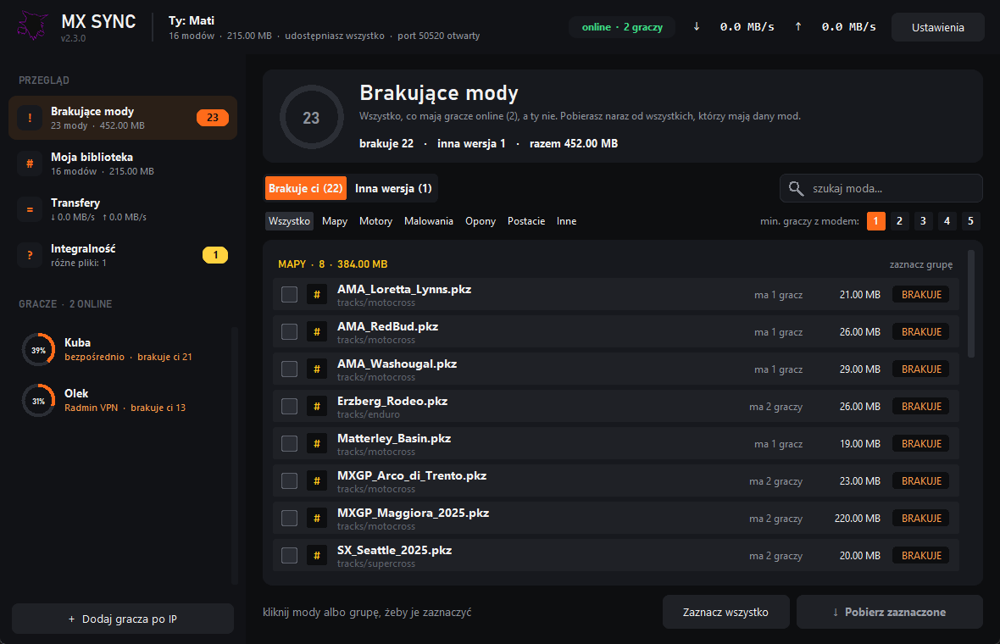
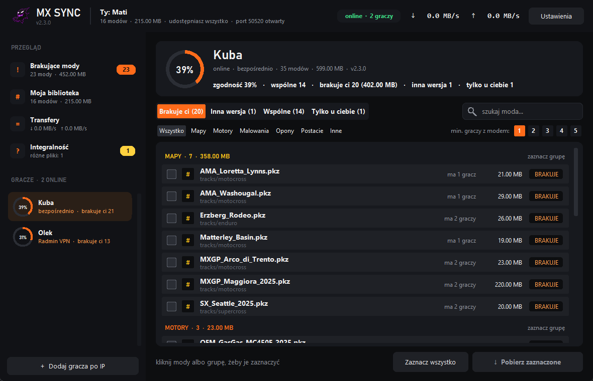
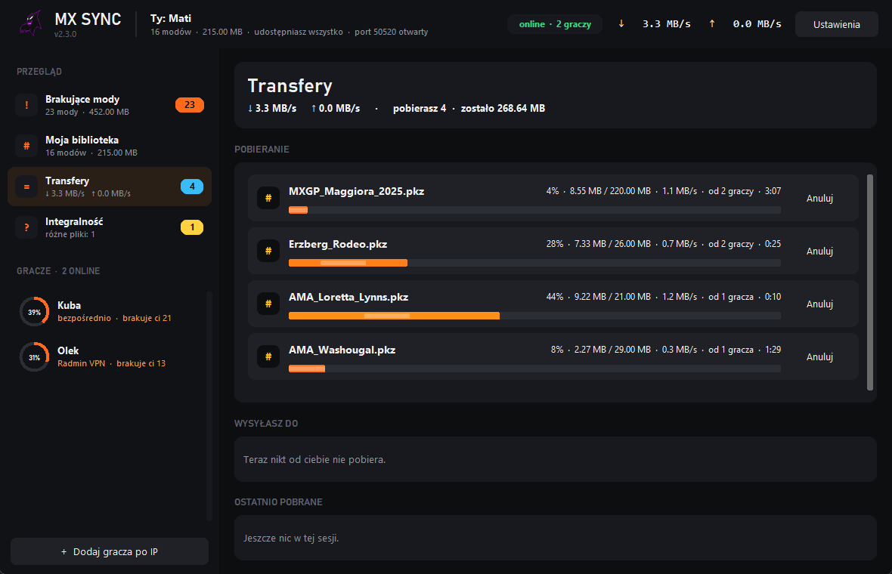
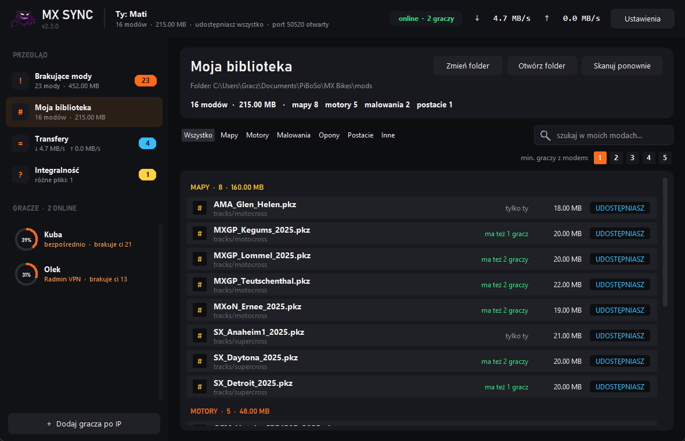
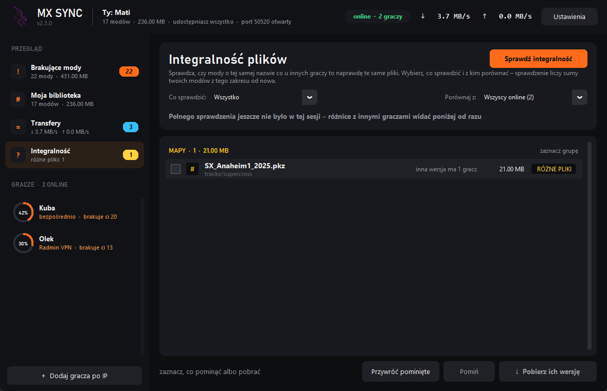
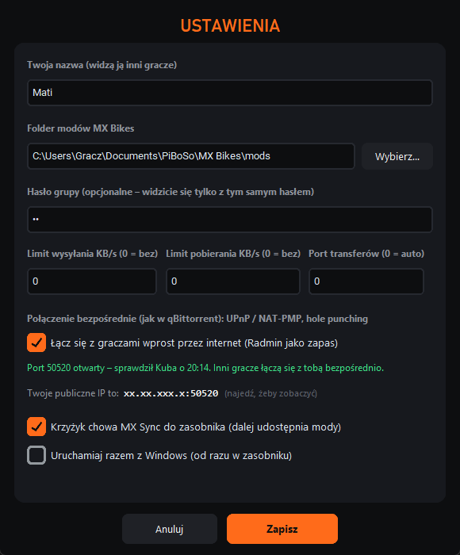

# MX Sync

Wymiana modów MX Bikes między znajomymi – jak torrent. Każdy gracz udostępnia swój folder modów, widzi,
czego mu brakuje w porównaniu z innymi, i pobiera to jednym kliknięciem od wszystkich naraz.
Działa w sieci lokalnej, przez Radmin VPN i bezpośrednio przez internet.

## [Pobierz MX Sync – kliknij tutaj](https://github.com/Kadrixter/mx-sync/releases/latest/download/MXSync-Setup.exe)

Instalator dla Windows 10/11 (64-bit). Zawsze najnowsza wersja, program sam się potem aktualizuje.
Windows może pokazać „Nieznany wydawca” – kliknij „Więcej informacji”, a potem „Uruchom mimo to”.

## Jak to działa

1. Instalujesz i uruchamiasz MX Sync. Folder modów MX Bikes wykrywa się sam
   (`Dokumenty\PiBoSo\MX Bikes\mods`), a program przygotowuje twoje mody do udostępniania.
2. Inni gracze z MX Sync pojawiają się sami po lewej – w tej samej sieci, w Radmin VPN albo przez internet.
   Gracze przekazują sobie listy znajomych, więc wystarczy, że widzisz jednego, żeby zobaczyć resztę.
3. Przy każdym graczu kółko z procentem pokazuje, jak bardzo wasze mody się zgadzają.
4. W „Brakujące mody” widzisz wszystko, co mają inni, a ty nie. Zaznaczasz i klikasz „Pobierz zaznaczone”.
5. Mod pobiera się naraz od wszystkich, którzy go mają, a ty od razu wysyłasz pobrane kawałki dalej –
   im więcej graczy, tym szybciej.

## Gracze i porównanie modów

Po kliknięciu gracza widać, czego ci brakuje, co masz w innej wersji, co macie wspólne i co jest tylko u ciebie.
Mody są pogrupowane: Mapy, Motory, Malowania, Opony, Postacie (kaski, gogle, stroje, rękawice, buty…) i Inne.
Folder z paczkami (np. cały sezon torów) to grupa – jednym kliknięciem zaznaczasz wszystko z niej.

- **Wyszukiwarka** – po nazwie, grupie i folderze; znaki `_ - .` są pomijane (`spa` albo `1998` znajdzie `0xspa1998.pkz`).
- **Filtr „min. graczy z modem”** – pokazuje tylko mody, które ma co najmniej tylu graczy.
- **Inna wersja** – gdy masz mod o tej samej nazwie, ale z inną zawartością, możesz pobrać wersję innych;
  pobierane są tylko zmienione pliki.

## Transfery

Postęp każdego modu, prędkość, od ilu graczy pobierasz i ile zostało. Niżej widać, komu i jak szybko wysyłasz,
oraz ostatnio pobrane mody.

## Moja biblioteka

Wszystkie twoje mody i przy każdym informacja, ilu graczy też go ma. Folder modów można zmienić, otworzyć
albo przeskanować ponownie. Nowe i zmienione mody program wykrywa sam.

## Integralność

Sprawdza, czy mody o tej samej nazwie co u innych to naprawdę te same pliki. Wybierasz, co sprawdzić
(wszystko, mapy, motory, postacie…) i z kim porównać. Każdą różnicę możesz pominąć albo pobrać wersję innych.

## Połączenie bezpośrednie (jak w qBittorrent)

MX Sync sam otwiera port na routerze (UPnP / NAT-PMP) i dzieli się twoim publicznym IP tylko z graczami
z tym samym hasłem grupy. Dzięki temu pobierasz od innych wprost przez internet, a nie przez wolniejszy tunel
Radmina – Radmin i sieć lokalna zostają jako zapas.

- Inny gracz sprawdza, czy twój port jest naprawdę otwarty („port 50520 otwarty – sprawdził Kuba”).
- Gdy port jest zamknięty u obu stron, program próbuje hole punchingu (obaj łączycie się do siebie naraz).
- Wykrywa CGNAT operatora i podwójny router – wtedy mówi wprost, że zostaje Radmin.
- Otwarty port wpuszcza tylko znanych graczy MX Sync.
- Przy graczu widać, jak jesteście połączeni: bezpośrednio, Radmin VPN albo LAN.

Jeśli router nie obsługuje UPnP, włącz je w panelu routera albo przekieruj ręcznie port **50520 TCP i UDP**
na swój komputer.

## Ustawienia

- **Nazwa gracza** – widzą ją inni.
- **Hasło grupy** – widzicie się tylko z osobami z tym samym hasłem; samo hasło nie idzie przez sieć.
- **Limity** wysyłania i pobierania oraz własny port transferów.
- **Połączenie bezpośrednie** – włącznik (domyślnie włączony), stan portu i twoje publiczne IP,
  zasłonięte iksami – cyfry widać dopiero po najechaniu myszką.
- **Zasobnik** – krzyżyk chowa MX Sync obok zegara, a mody dalej się udostępniają. Opcjonalnie start razem z Windows.

## Aktualizacje

Program sprawdza nowe wersje przy starcie i co 10 minut. Gdy jest nowa, u góry okna pojawia się pomarańczowy
pasek – kliknięcie pobiera instalator, instaluje i uruchamia MX Sync ponownie.

## Porty

| Port | Protokół | Do czego |
|------|----------|----------|
| 50515 | UDP | wyszukiwanie graczy w sieci i w Radmin VPN |
| 8888 | TCP | informacje o graczu i jego modach |
| 50520 | TCP + UDP | przesyłanie modów (ten port warto otworzyć na routerze) |

Instalator sam dodaje MX Sync do zapory Windows.

---

Budowanie, struktura kodu i wydawanie wersji: [docs/ROZWOJ.md](docs/ROZWOJ.md).
